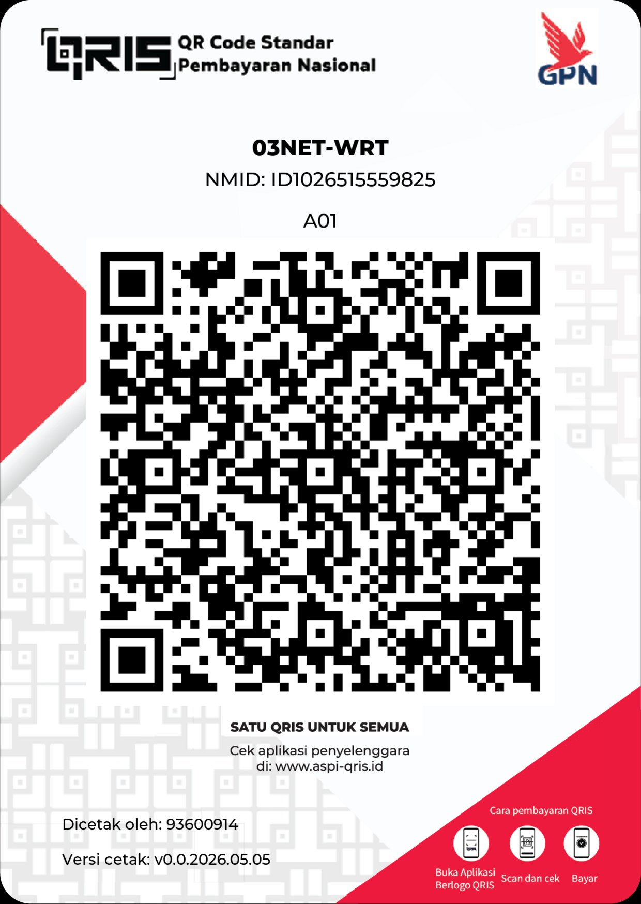

# 03NET OpenWrt for ZTE E8820S

Custom OpenWrt firmware for the **ZTE E8820S** router, branded **03NET** and
pre-loaded with the tools we actually use: web terminal, file manager and
USB modem drivers.

## Default login

```
LuCI            : http://192.168.1.1
user            : root
password        : 03NETWRT

Wi-Fi 2.4GHz    : 03NET-WRT
Wi-Fi 5GHz      : 03NET-WRT 5G
Wi-Fi password  : 03NETWRT
```

## What's inside

- Base: official OpenWrt (ramips/mt7621), built with the official pre-compiled
  toolchain so kernel modules match official OpenWrt builds
- **Theme**: material (default), with 03NET-WRT logo in the header and a
  custom wallpaper on the login page
- **Terminal**: `ttyd` + `luci-app-ttyd`
- **File manager**: TinyFM (`luci-app-tinyfm`, by bobbyunknown)
- **Extra tools**: Tailscale (`luci-app-tailscale`), DiskMan (`luci-app-diskman`)
- **Modem drivers**: `kmod-usb-serial-*` (option, qualcomm, sierrawireless,
  wwan), `kmod-usb-net-*` (qmi-wwan, mbim, rndis, cdc-ncm, huawei),
  `usb-modeswitch`, ModemManager + `luci-proto-modemmanager`, sms-tool
- **USB storage**: `kmod-usb-storage`, `block-mount`
- **WiFi maxed out**: full `wpad` (WPA3-SAE, OWE, 802.11r roaming, WPS),
  USB WiFi dongle drivers (rt2800, rtl8xxxu, mt76x0u, mt76x2u, ath9k-htc),
  `hostapd-utils`
- Branding: 03NET banner, hostname `03NET-E8820S`

## Installation

This firmware requires **BREED** bootloader to flash.

If your unit runs **U-Boot mod**, use the official ImmortalWrt build instead.

1. Reboot to BREED web recovery: power on the router while holding the reset
   button for about 5 seconds
2. Connect via LAN1 and open http://192.168.1.1
3. Flash `openwrt-*-ramips-mt7621-zte_e8820s-squashfs-factory.bin`
   with the **HC5962** layout

## Upgrading

Flash `openwrt-*-ramips-mt7621-zte_e8820s-squashfs-sysupgrade.bin`
via LuCI (System -> Backup / Flash Firmware).

## Building

Pushing to `main` (or running the workflow manually) triggers a GitHub
Actions build:

- `config/03net.config` - package selection + 03NET branding
- `patch/` - device tree, LED, sysupgrade and image definitions for E8820S
- `overlay/` - files copied into the firmware image (banner, LuCI logo,
  login wallpaper)
- TinyFM is cloned at build time from bobbyunknown/luci-app-tinyfm

To change the OpenWrt version, run the workflow manually with another tag
(e.g. v24.10.8).

## Credits

- Device patches: Maizil41/ZTE-E8820S, based on TwoOnefour and ImmortalWrt
- TinyFM: bobbyunknown/luci-app-tinyfm
- OpenWrt project

## Donasi

Dukung pengembangan 03NET-WRT via QRIS:



Powered by **03NET** - Telegram @O3netwrt77
